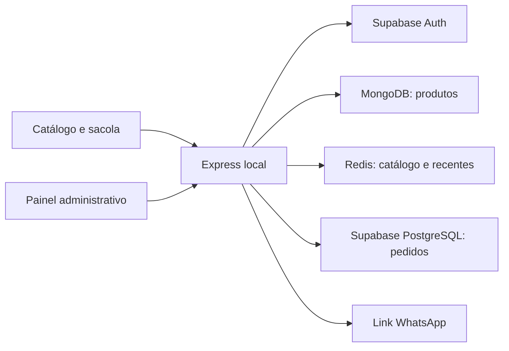

# Essência — Catálogo Poliglota

Catálogo de produtos com painel administrativo, sacola e pedido pelo WhatsApp. O projeto aplica três bancos em funções distintas: **Supabase para identidade e pedidos, MongoDB para produtos e Redis para cache e itens recentes**.

- Aluno: Carlos Gabriel Raposo Landim
- Disciplina: Projeto de Banco de Dados — 26/2
- Trabalho: 3ª avaliação, 6 pontos, prazo 26/11/2026 às 23h30
- [Repositório](https://github.com/karlitus222/catalogo-poliglota-2026-2)
- Situação: implementação e testes de integração preparados; revisão visual e vídeo pendentes. A entrega no Gennera será feita após o vídeo.

## Problema e proposta

Uma pequena loja precisa apresentar seus produtos, atualizar a coleção e receber pedidos sem implementar processamento de pagamentos. O cliente pesquisa, consulta detalhes, adiciona itens à sacola e prepara uma mensagem com quantidades e total. O administrador entra com sua conta e cadastra ou edita produtos. Um painel permite conferir o papel e a conexão dos três bancos.

A marca e os produtos são fictícios. As ilustrações SVG locais fazem parte do código e não dependem de serviços externos.

## Requisitos atendidos

| Exigência                     | Implementação                                                                                          |
| ----------------------------- | ------------------------------------------------------------------------------------------------------ |
| Interface gráfica             | Catálogo, filtros, detalhes, sacola, login e painel de gestão                                          |
| Login administrativo Supabase | `signInWithPassword`, validação de usuário no servidor e autorização por `app_metadata.catalogo_admin` |
| Produtos MongoDB              | Documentos com nome, descrição, preço em centavos, imagem e atributos variáveis                        |
| Cache Redis                   | Catálogo com TTL de 30 segundos e invalidação após cadastro/edição                                     |
| Produtos vistos recentemente  | Sorted set por visitante, até oito itens, TTL de 24 horas                                              |
| Carrinho                      | Adicionar, remover e alterar quantidade; persistência local no navegador                               |
| WhatsApp                      | Link `wa.me` com itens, quantidades, total e referência; cliente revisa e envia                        |
| Outros usos Supabase          | Registro do pedido no PostgreSQL e consulta pelo administrador                                         |
| Código e configuração         | Este repositório, Docker Compose, migração, instalador e `.env.example`                                |
| Vídeo de 5 a 10 minutos       | Pendente, reservado para a etapa final                                                                 |

## Executar localmente

Requisitos: Node.js 22 ou superior, npm, Git e Docker Desktop com engine Linux aberta. Validado com Node 24.15. A primeira instalação baixa imagens; precisa de internet e recursos para o ambiente Supabase.

```sh
git clone https://github.com/karlitus222/catalogo-poliglota-2026-2.git
cd catalogo-poliglota-2026-2
npm ci
npm run infra:start
npm run supabase:start
npm run local:config
npm run setup
npm start
```

Abra **http://127.0.0.1:3026**. No PowerShell, se `npm.ps1` estiver bloqueado, use `npm.cmd` nos comandos npm.

`local:config` cria `.env` a partir da CLI do Supabase local e gera uma senha aleatória. Nenhuma credencial é impressa. Para entrar, use **Área da loja** no menu ou abra **http://127.0.0.1:3026/admin** e use `ADMIN_EMAIL` e `ADMIN_PASSWORD` do seu `.env`. O e-mail inicial é `admin@catalogo.local`. `setup` cria a conta apenas se ela ainda não existir; não altera senhas de contas existentes.

Edite `WHATSAPP_NUMBER` em `.env` com o destino da loja no formato **55 + DDD + número**, só dígitos. O valor de exemplo é propositalmente inválido: o app impede finalizar sem configuração. Reinicie o servidor após alterar. O ambiente do autor já tem seu destino configurado; o número não está publicado no código.

O Supabase é o ambiente local oficial, com Auth, PostgreSQL e Data API reais. Não é necessário criar uma conta na nuvem. MongoDB e Redis também são serviços reais em Docker. Nenhuma integração é simulada.

### Configuração

| Variável                        | Uso                                                    |
| ------------------------------- | ------------------------------------------------------ |
| `PORT`                          | Porta da aplicação; padrão do ambiente 3026            |
| `SUPABASE_URL`                  | URL da API local; 54421                                |
| `SUPABASE_DB_URL`               | Conexão SQL usada pelo instalador e limpeza dos testes |
| `SUPABASE_SECRET_KEY`           | Chave privilegiada, apenas no servidor                 |
| `SUPABASE_PUBLISHABLE_KEY`      | Cliente de autenticação; também mantido no servidor    |
| `MONGODB_URL`                   | Conexão local em 27026                                 |
| `MONGODB_DATABASE`              | Banco `catalogo_poliglota`                             |
| `REDIS_URL`                     | Conexão local em 6396                                  |
| `CACHE_TTL`                     | Expiração do catálogo em segundos; padrão 30           |
| `ADMIN_EMAIL`, `ADMIN_PASSWORD` | Conta criada pelo instalador                           |
| `WHATSAPP_NUMBER`               | Destino dos pedidos, sem espaços ou símbolos           |

Outras portas: Supabase PostgreSQL 54422 e Studio 54423. Em caso de conflito, altere o Compose, `supabase/config.toml` e `.env` de forma correspondente. A aplicação e as portas publicadas de MongoDB/Redis escutam apenas em loopback. O ambiente Supabase local deve permanecer em máquina de desenvolvimento confiável.

### Parar e voltar

Ctrl+C encerra o Node. Para parar a infraestrutura preservando volumes:

```sh
docker compose stop
npx supabase stop
```

Para retomar, inicie os serviços pelos mesmos comandos de instalação e execute `npm start`. Repita `setup` se necessário: os produtos de demonstração são inseridos com `setOnInsert`, preservando alterações anteriores. Não use `docker compose down -v` ou `supabase db reset` sobre dados que queira manter.

## Arquitetura e decisões



### Supabase: autenticação e pedidos

O login usa `signInWithPassword`. O servidor guarda o token em uma sessão identificada por cookie `HttpOnly` e `SameSite=Strict`; tokens e chaves não ficam no localStorage. Em cada rota administrativa, `getUser(token)` consulta o Supabase e a permissão é conferida em `app_metadata.catalogo_admin`. `user_metadata` não concede acesso. A sessão dura até uma hora ou até expirar o token; reiniciar o Node encerra as sessões e exige novo login. Não há renovação automática de sessão nesta versão.

O PostgreSQL armazena o identificador UUID do pedido, itens com preço congelado, total em centavos e data. A tabela `catalogo_pedidos` tem RLS habilitada; `anon` e `authenticated` não recebem acesso direto. As rotas usam chave de servidor e exigem administrador para listar pedidos. Não são armazenados nome, telefone ou endereço do cliente.

### MongoDB: cadastro e armazenamento dos produtos

A coleção `produtos` é a fonte de verdade para o catálogo. Cada documento contém `_id`, nome, descrição, categoria, imagem, preço inteiro em centavos, atributos, versão e datas. `atributos` é um objeto flexível: uma garrafa informa volume; uma mochila, capacidade. Isso evita adicionar colunas específicas para cada categoria. Há índices para nome e para ativo/categoria.

O cadastro e a edição são restritos. O formulário oferece seis ilustrações locais; o campo de imagem armazena seu caminho. A versão do documento é comparada no update: duas edições concorrentes não sobrescrevem silenciosamente uma à outra. O usuário deve recarregar ao receber conflito.

### Redis: cache e histórico recente

A primeira listagem é MISS: lê o MongoDB e salva a resposta por 30 segundos. Leituras seguintes são HIT e dispensam a consulta ao MongoDB. Gravações confirmadas invalidam o cache. O controle de geração com `MULTI` e Lua impede que uma consulta antiga republique resultado depois de uma invalidação. O código de cache foi reaproveitado e adaptado do trabalho anterior.

Os itens vistos usam `catalogo:recentes:<UUID-do-visitante>` em sorted sets: ID como membro, horário como score, limite de oito produtos e expiração de 24 horas. O UUID fica em cookie HttpOnly separado da autenticação. Reabrir o mesmo produto atualiza sua posição sem duplicá-lo. Visitantes diferentes têm chaves distintas; produtos são lidos novamente no MongoDB para exibir o histórico.

Se o Redis cair, o catálogo funciona com BYPASS e consulta direta ao MongoDB. O histórico recente informa indisponibilidade; não inventa dados. Na reconexão, o cache do catálogo é descartado antes da reutilização. Redis não persiste dados e pode perder o histórico, adequado à finalidade temporária. Limite de memória: 64 MB com `allkeys-lru`.

## Carrinho e finalização

O navegador guarda apenas IDs e quantidades no localStorage. Ao preparar o pedido, o servidor lê novamente os produtos no MongoDB e recalcula os valores: preço ou total enviado pelo navegador não é considerado. Quantidades devem ser inteiras de 1 a 99, sem IDs duplicados. Valores monetários usam centavos inteiros.

Após persistir o pedido no Supabase, a tela apresenta o texto e o link do WhatsApp. O usuário clica em **Abrir WhatsApp** e revisa a mensagem. Isso não envia automaticamente mensagens, não cobra e não confirma disponibilidade. Os registros no painel são pedidos iniciados, não vendas pagas. A sacola permanece para facilitar uma nova consulta; atualizar quantidades requer preparar outro pedido.

Não há transação distribuída entre MongoDB e PostgreSQL: os preços são capturados do MongoDB no momento da preparação, e o snapshot é salvo no PostgreSQL. Falha nessa gravação impede apresentar o link como pedido concluído. A loja confirma disponibilidade e condições posteriormente.

## Testes e verificação

Com os serviços e `setup` preparados:

```sh
npm test
npx supabase db advisors --local --type security --level warn --fail-on warn
npm audit
```

Em 21/11/2026: **11 testes aprovados, sem falhas ou ignorados**; advisor Supabase sem problemas; auditoria npm sem vulnerabilidades reportadas. Os testes cobrem validação monetária, proteção administrativa, origem externa, login real, documentos MongoDB, edição concorrente, cache/TTL, recentes isolados, cálculo do pedido, URL WhatsApp, persistência PostgreSQL, RLS e logout.

São criados apenas registros de teste identificáveis e prefixos de cache exclusivos. A limpeza apaga esses registros ao terminar. O destino do WhatsApp é verificado pela URL sem enviar mensagem.

**Conferência visual pendente:** a ferramenta de controle do navegador foi interrompida por não conseguir identificar a URL com segurança. Os testes de API não substituem a revisão das telas. Confira o roteiro em [docs/validacao.md](docs/validacao.md) antes de gravar o vídeo.

## Segurança e limites

Aplicação acadêmica local, com uma instância Node. O cookie usa `Secure` em `NODE_ENV=production`, mas produção exige HTTPS, configuração e avaliação específicas. Há CSP restritiva, validação de entradas, limite de corpo JSON, verificação de origem em gravações e limite de tentativas de login. A autorização usa dados validados pelo Supabase, nunca uma indicação fornecida pelo cliente.

Não expor os bancos locais ou esta aplicação diretamente à internet. MongoDB local não usa senha porque a porta está restrita a loopback no ambiente de desenvolvimento. Para produção, exigir autenticação dos bancos, TLS, gestão de segredos, limites adicionais, logs, backups e infraestrutura de sessão apropriada. A aplicação não promete consistência distribuída entre várias instâncias durante falha de cache. Alterações diretas no MongoDB podem ficar até 30 segundos fora do cache.

## Organização

- `src/app.js`: rotas, autenticação, recentes e finalização.
- `src/domain.js`: regras e cálculo de valores.
- `src/cache.js`: TTL, invalidação e continuidade sem Redis.
- `src/server.js`: conexões e inicialização.
- `public/`: interface responsiva e ilustrações.
- `scripts/`: configuração e instalação idempotente.
- `banco/schema.sql`, `supabase/migrations/`: tabela de pedidos e permissões.
- `tests/`: testes com os três serviços reais.
- `docs/`: matriz de revisão e roteiro da demonstração.

## Referências

[Supabase Auth: login por senha](https://supabase.com/docs/reference/javascript/auth-signinwithpassword), [validação do usuário](https://supabase.com/docs/reference/javascript/auth-getuser), [ambiente local oficial](https://supabase.com/docs/guides/local-development/cli/getting-started), [MongoDB: documentos](https://www.mongodb.com/docs/drivers/node/current/crud/insert/), [Redis para Node.js](https://redis.io/docs/latest/develop/clients/nodejs/).
